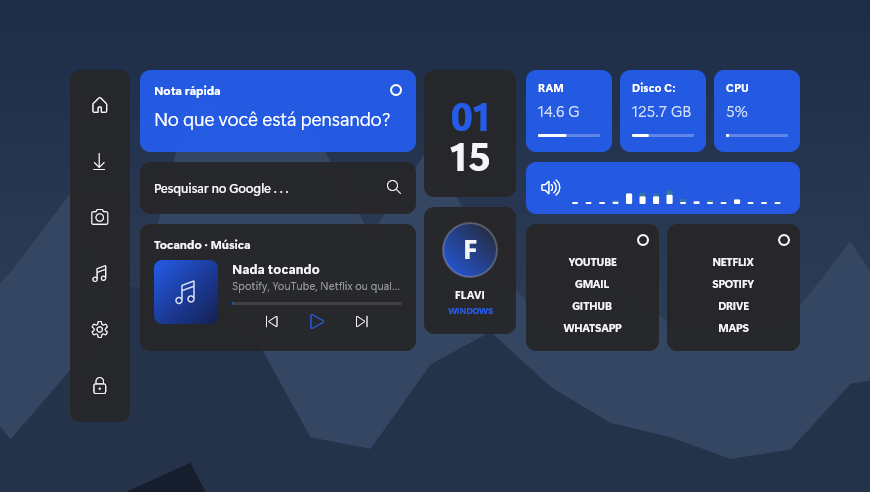
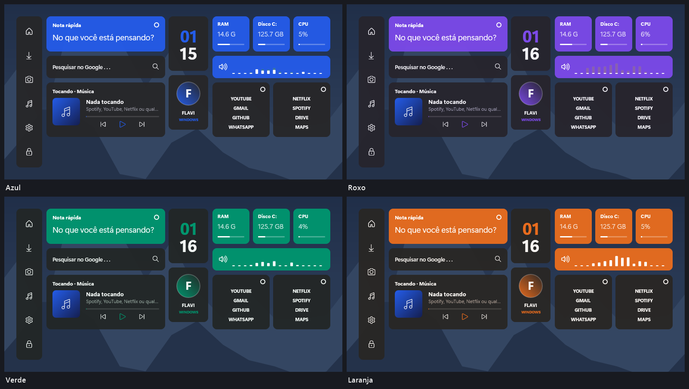
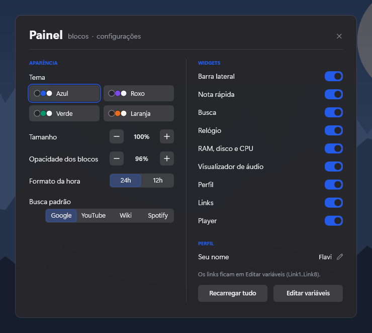

# Painel

**Blocos escuros com destaque colorido: nota, busca, visualizador, links e player.**

*Panel — Dark blocks with a colorful accent: note, search, visualizer, links and player.*

Agora também em inglês · Now also in English · [English below](#english)

Skin para o [Rainmeter](https://www.rainmeter.net), minimalista e com tela de configurações própria.

[**⬇ Baixar Painel.rmskin**](https://github.com/flavioferr/rainmeter-painel/releases/latest/download/Painel.rmskin)

## Sobre

O Painel organiza a área de trabalho em blocos retos, com uma cor de destaque. Tem busca (Google, YouTube, Wikipédia, Spotify), um visualizador de áudio ao vivo e uma grade de links.

## Widgets

| Widget | O que mostra |
|---|---|
| **Barra lateral** | atalhos verticais |
| **Nota rápida** | uma linha editável |
| **Busca** | digite e Enter; clique no buscador para trocar |
| **Relógio** | horas e minutos empilhados |
| **Sistema** | RAM, disco C: e CPU |
| **Visualizador** | barras do áudio tocando, ao vivo |
| **Perfil** | inicial e nome |
| **Links** | 8 sites configuráveis |
| **Player** | capa, faixa, progresso e controles |

## Temas

4 temas prontos: Azul, Roxo, Verde, Laranja.

## Configurações

Clique com o botão direito em qualquer widget → **Configurações**. Tudo é salvo na hora.

- Tema (4 opções)
- Tamanho dos widgets (70% a 160%)
- Opacidade dos blocos
- Busca padrão
- Seu nome
- Hora em 24h ou 12h
- Sua cidade (coordenadas buscadas automaticamente)
- Ligar/desligar cada widget

## Instalação

1. Instale o [Rainmeter](https://www.rainmeter.net) (4.5 ou mais novo).
2. Baixe o [`Painel.rmskin`](https://github.com/flavioferr/rainmeter-painel/releases/latest) na página de Releases.
3. Dê dois cliques no arquivo e clique em **Install**.
4. Na primeira vez, os widgets aparecem já posicionados e as configurações abrem sozinhas.

Prefira o `.rmskin`: ele já instala o plugin de música. A pasta [`Painel`](Painel) tem o código da skin.

## Dicas

- **Idioma:** botão direito em qualquer widget → **English** (ou o botão **EN** nas configurações). Para voltar, **Português**.
- **Música:** o player lê tudo que aparece nos controles de mídia do Windows — Spotify, YouTube, Netflix e qualquer site no Chrome/Edge/Firefox, Apple Music, Deezer, VLC… O plugin [WebNowPlaying](https://github.com/keifufu/WebNowPlaying-Rainmeter) (MIT) já vem dentro do `.rmskin`; a [extensão do navegador](https://wnp.keifufu.dev) é opcional. Clique na barra de progresso para pular.
- **Clima:** digite sua cidade nas configurações; as coordenadas são buscadas sozinhas (se não encontrar, tente sem acento). Os dados vêm do [Open-Meteo](https://open-meteo.com), gratuito e sem chave de API.
- **Mover:** arraste os widgets com o mouse.
- **Ajustes avançados:** o botão *Editar variáveis* abre o `@Resources/Variables.inc`.

## Requisitos

Windows 10 ou 11 e Rainmeter 4.5+. As fontes usadas já vêm com o Windows 11. Se o player ficar vazio, instale o [Microsoft Visual C++ Redistributable](https://aka.ms/vs/17/release/vc_redist.x64.exe), usado pelo plugin de música.

## Coleção

Outras skins da mesma leva:

- [Divisa](https://github.com/flavioferr/rainmeter-divisa) — Horas gigantes de um lado, música, clima e frase do dia do outro.
- [Serra](https://github.com/flavioferr/rainmeter-serra) — Vidro fosco: barra de menu, central de controle, widgets e dock.
- [Mosaico](https://github.com/flavioferr/rainmeter-mosaico) — Um kit de 9 cartões: relógio, lembretes, cronômetro, música, previsão e mais.
- [Eixo](https://github.com/flavioferr/rainmeter-eixo) — Um eixo central minimalista: saudação, dia da semana gigante, data e hora.
- [Maré](https://github.com/flavioferr/rainmeter-mare) — Vidro e música: a capa do que está tocando vira o cartão.
- [Bússola](https://github.com/flavioferr/rainmeter-bussola) — Tudo em círculos: relógio em anel, disco que gira e medidores.
- [Lousa](https://github.com/flavioferr/rainmeter-lousa) — Escrito à mão: lista do dia, recado adesivo e um player de fita cassete.
- [Console](https://github.com/flavioferr/rainmeter-console) — Terminal: fetch do sistema, prompt de busca, todo.txt e player em ASCII.
- [Régua](https://github.com/flavioferr/rainmeter-regua) — A linha do dia: régua de 24h com o agora, nascer e pôr do sol.

E mais 12 na coleção: [Lumen](https://github.com/flavioferr/rainmeter-lumen), [Horizon](https://github.com/flavioferr/rainmeter-horizon), [Orbit](https://github.com/flavioferr/rainmeter-orbit), [Shell](https://github.com/flavioferr/rainmeter-shell), [Folio](https://github.com/flavioferr/rainmeter-folio), [Bento](https://github.com/flavioferr/rainmeter-bento), [Prisma](https://github.com/flavioferr/rainmeter-prisma), [Linea](https://github.com/flavioferr/rainmeter-linea), [Pixel](https://github.com/flavioferr/rainmeter-pixel), [Soft](https://github.com/flavioferr/rainmeter-soft), [Swiss](https://github.com/flavioferr/rainmeter-swiss) e [Island](https://github.com/flavioferr/rainmeter-island).

---

## English

**Panel** — Dark blocks with a colorful accent: note, search, visualizer, links and player.

A minimalist skin for [Rainmeter](https://www.rainmeter.net) with its own settings screen, now in **English and Portuguese**.

### Widgets

| Widget | What it shows |
|---|---|
| **Clock** | Hours over minutes in a square block. |
| **Links** | Two blocks with four links each. Change names and addresses in @Resources\Variables.inc. |
| **Quick note** | Quick note on a highlighted block. Click the text to edit. |
| **Player** | Cover, track, artist, progress and controls in a block. |
| **Profile** | Your name with an initials avatar. |
| **Search** | Search box. Click, type and press Enter; the default search engine is in the settings. |
| **Sidebar** | Vertical shortcuts: home, downloads, pictures, music, settings and lock. |
| **System** | Used RAM and disk and CPU in three blocks. |
| **Audio visualizer** | Bars that dance with the sound playing on the computer. |

### Themes

4 ready-made themes: Blue, Purple, Green, Orange.

### Installation

1. Install [Rainmeter](https://www.rainmeter.net) (4.5 or newer).
2. Download [`Painel.rmskin`](https://github.com/flavioferr/rainmeter-painel/releases/latest) from the Releases page.
3. Double-click the file and click **Install**.
4. Right-click any widget and choose **English**. The whole suite switches language (and back with **Português**).

### Tips

- **Settings:** right-click any widget → **Settings** (there is also an **EN/PT** button next to the close button).
- **Music:** the player reads everything in the Windows media controls — Spotify, YouTube, Netflix and any website in the browser, Apple Music, Deezer, VLC… The [WebNowPlaying](https://github.com/keifufu/WebNowPlaying-Rainmeter) plugin (MIT) is included in the `.rmskin`.
- **Weather:** type your city in the settings; the coordinates are looked up automatically. Data from [Open-Meteo](https://open-meteo.com), free and without an API key.

### Requirements

Windows 10 or 11 and Rainmeter 4.5+. If the player stays empty, install the [Microsoft Visual C++ Redistributable](https://aka.ms/vs/17/release/vc_redist.x64.exe).

### License

[CC BY-NC-SA 4.0](LICENSE.md) — use, modify and share with credit, non-commercially.

---

## Licença

[CC BY-NC-SA 4.0](LICENSE.md) — use, modifique e compartilhe, dando crédito e sem fins comerciais.
O plugin WebNowPlaying incluído no `.rmskin` é de [keifufu](https://github.com/keifufu/WebNowPlaying-Rainmeter), sob licença MIT.
